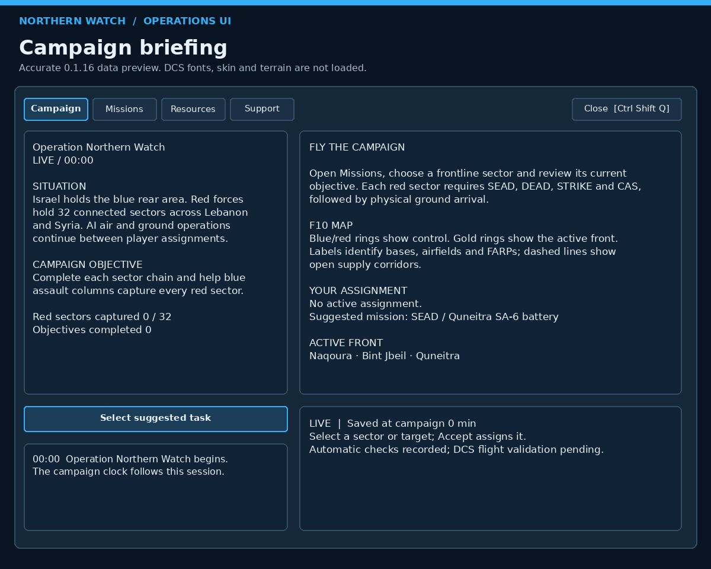
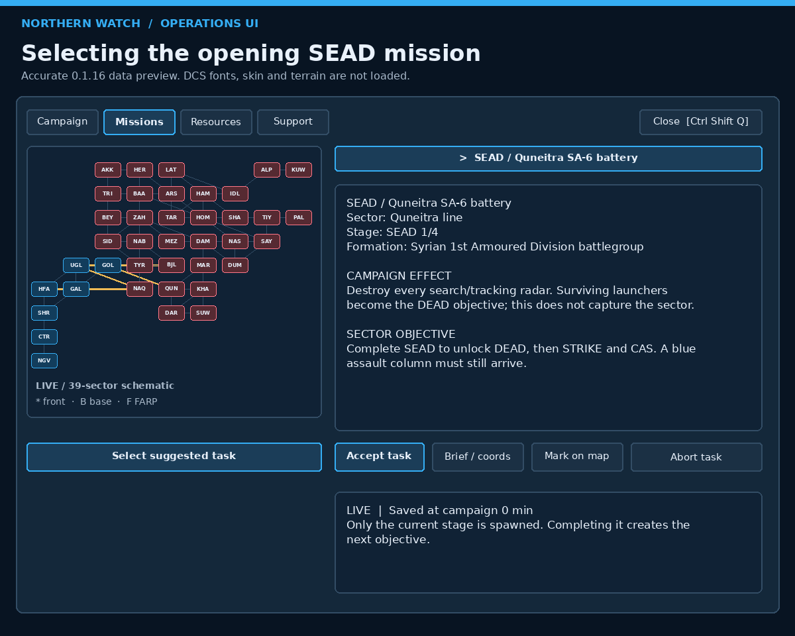
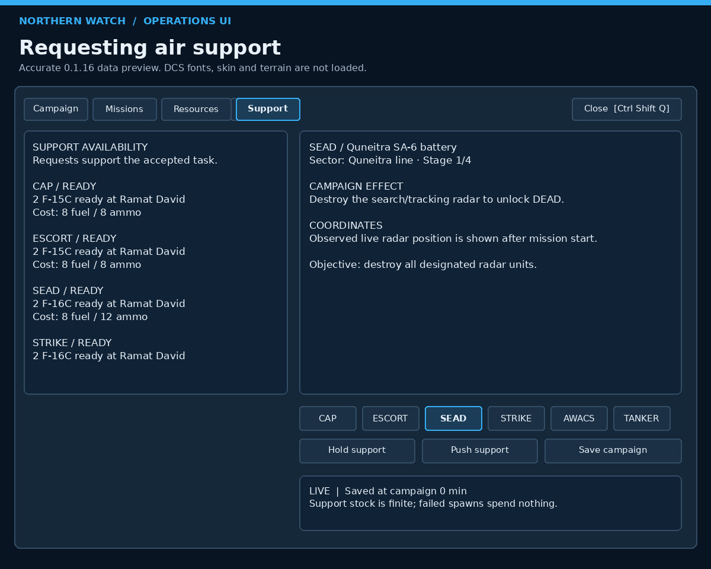
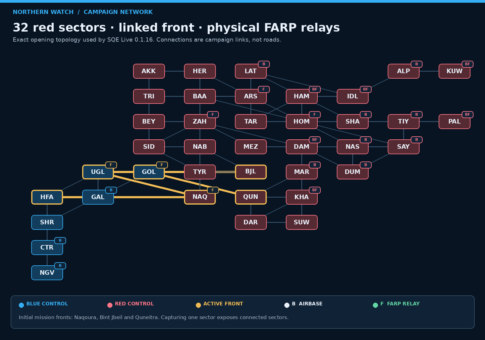
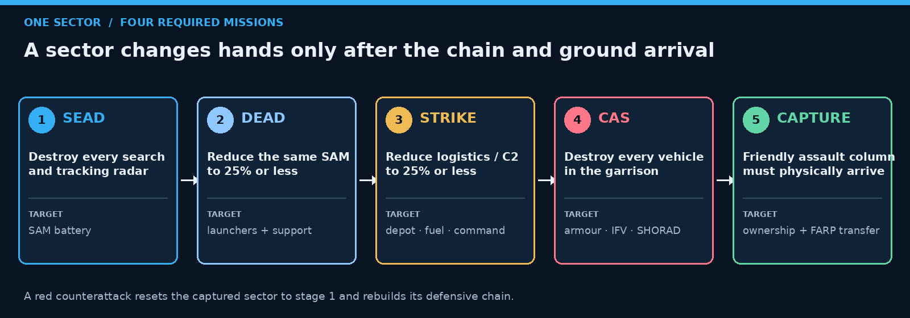
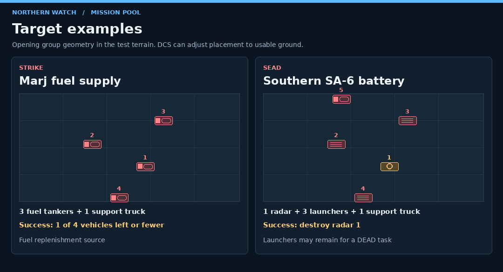
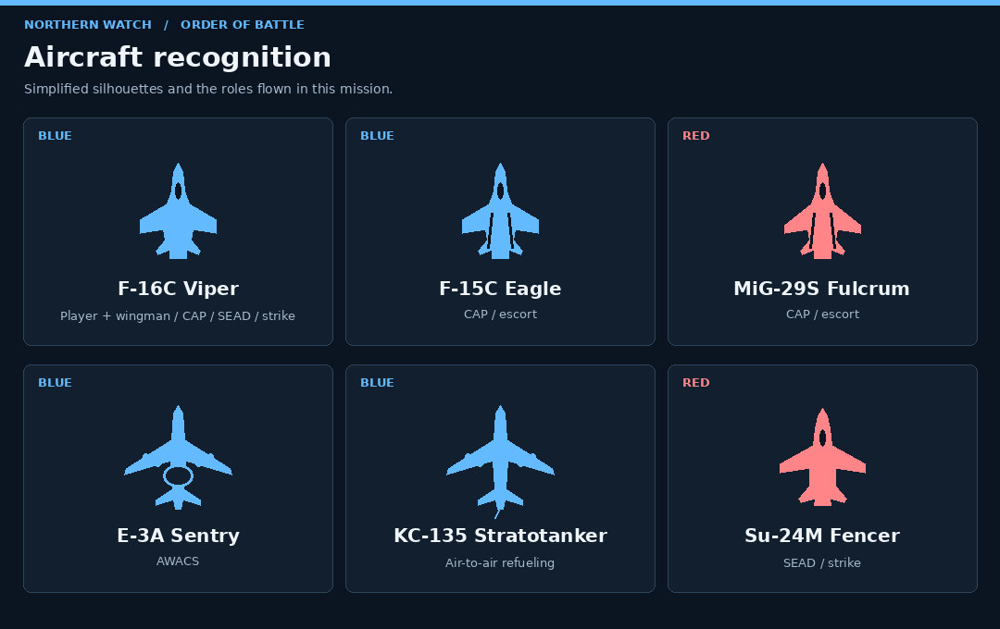
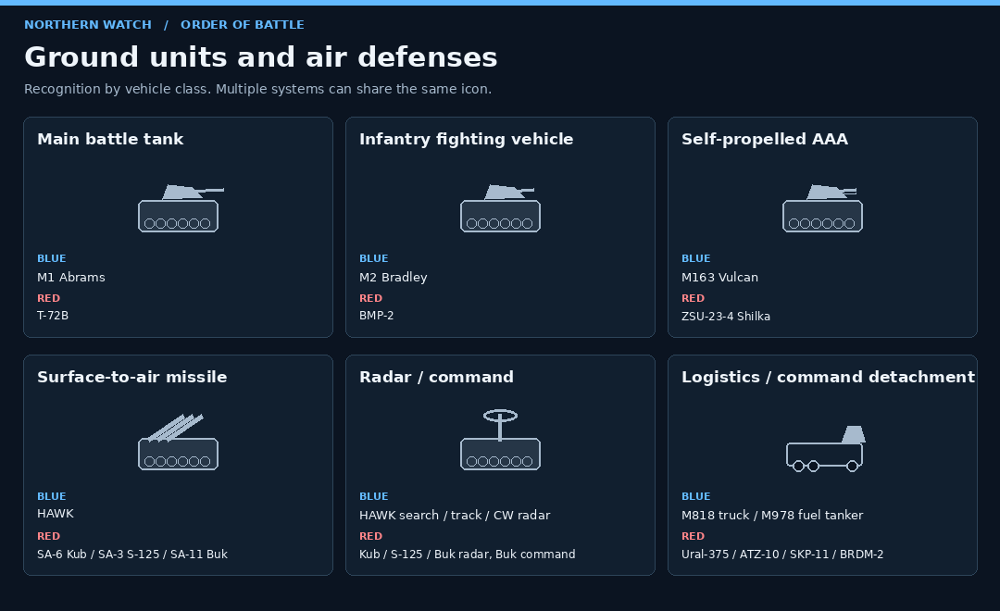
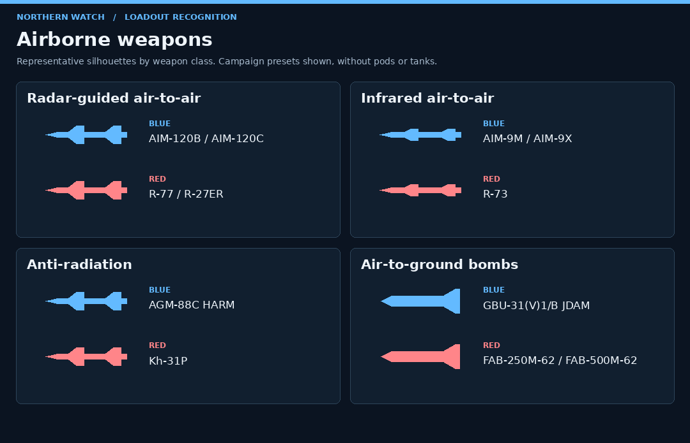

# Operation Northern Watch — מדריך שחקן

SQE Live 0.1.16 · DCS Syria · F-16C · קמפיין סולו

## המערכה

בתרחיש הבדיוני הזה הכוח הכחול מתחיל בכל ישראל, והכוח האדום מחזיק ב־32
אזורים מחוברים בלבנון ובסוריה. המשימה שלך היא לשמור על השדות וקווי
האספקה הכחולים, לפרוץ צפונה ומזרחה ולעזור לכוחות הקרקע להשתלט בהדרגה
על כל רשת המערכה. החזית אינה מתקדמת לפי תסריט קבוע: השליטה, האבדות,
האספקה והכוחות שבאמת הגיעו קובעים אילו משימות ייפתחו.

אתה מוביל מבנה F-16C מרמת דוד. **Viper 1-2** הוא הווינגמן שלך. שני הצדדים
מפעילים גיחות, שיירות וכוחות קרקע בזמן שהסימולציה רצה. אפשר להמתין על
הקרקע, לטוס בלי הקצאה, או לבצע כמה גיחות מאותו קובץ משימה. כיבוש דורש
פינוי מגינים והגעה פיזית של כוח ידידותי. גם אחרי שהשלמת גיחת CAS, ייתכן
שהכוח עדיין בדרך או ממתין לאספקה.

בפתיחה יש 14 בסיסי AI אדומים, מח׳לח׳לה ומרג׳ רוחייל ועד חמה, לטקיה,
חלב וכווירס. בנוסף יש 12 מנחתי FARP פיזיים, שניים כחולים ועשרה אדומים.
FARP מחובר לאזור שלו ומשמש ממסר לוגיסטי: כשהוא מושבת, נתיב ארוך עלול
להיחתך; כשאזור נכבש, גם הבעלות על ה־FARP עוברת. כיבוש אזור מעביר גם את
השדות והבסיסים השייכים לו וסוגר אותם לשיגורים של הצד שאיבד אותם.

כל צד שולח סיורי הגנה מעל החזית ומסיט אותם כשמזוהה כוח כיבוש נכנס.
מטוסי התקיפה מגיבים לכוחות שנעים אליהם ותוקפים גם מגינים וחילות מצב
בחזית היריבה. שני הצדדים שולחים כוחות קרקע כשאפשר להתקדם מגזרה מחוברת.

## מגיחה ראשונה לגיחה הבאה

1. סגור את DCS, חלץ את כל חבילת הגרסה והפעל **Install.cmd**. לאחר ההתקנה
   פתח **Missions → SQE-Live → SQE_Live_Syria** וצא מהשהיה כדי שהמשימה תתחיל.
2. לחץ **Ctrl+Shift+Q**. במסך **Campaign** קרא את הרקע, יעד המערכה,
   מצב החזית וההקצאה הנוכחית. לחץ **Select suggested task** כדי לעיין
   במשימה המומלצת, או בחר אחרת ב־**Missions**.
3. קרא את **Campaign effect**, את תנאי ההשלמה ואת האיומים. לחץ **Accept task**,
   אחר כך **Brief / coords** או **Mark on map**. אפשר לקבל משימה אחת בכל פעם.
4. ב־**Support** בדוק אם נדרש סיוע. עבור למפת **F10** כדי לזהות את החזית,
   השדה הידידותי והיעד שסימנת. סגור את חלון Operations באותו קיצור מקשים
   כדי להחזיר את השליטה לקוקפיט.
5. התניע את ה־F-16C לפי נוהל המודול, הכנס נקודת ניווט ליעד לפי הצורך,
   ובקש הסעה והמראה מ־ATC. טוס עם Viper 1-2, בצע את היעד ובדוק את ההודעה
   ואת יומן הקמפיין. אם נשארו מטרות בקבוצה, פתח שוב את התדריך או רענן את הסימון.
6. חזור לבסיס ידידותי. השתמש ב־**Ground Crew** של DCS לתדלוק ולחימוש
   על הקרקע. אפשר לבחור משימה נוספת ולהמריא באותו סשן. לפני יציאה לחץ
   **Save campaign**, המתן ל־**Saved** ופתח בפעם הבאה את אותו קובץ משימה.

## חלון Operations

תמונות החלון מדגימות את מבנה הכפתורים והמסכים בסביבת בדיקה. מפת 32
האזורים עודכנה ל־0.1.16; טקסט של יעד מסוים בתמונות הממשק עשוי להשתנות
לפי מצב החזית. המראה ב־DCS תלוי גם בסקין ובהגדרות התצוגה.

- **Campaign** מציג תדריך, התקדמות, חזית פעילה, משימה מוצעת והקצאה נוכחית.
  היומן בתחתית מתעד שיגורים, אבדות, מסירות ותוצאות.
- **Missions** מציג מפה סכמטית ורשימת משימות זמינות. לחץ על גזרה לסינון,
  או **All sectors** כדי לראות את כל המאגר. **Previous / Next** עוברים בין
  משימות ומחליפים דף במידת הצורך. בחירה ברשימה מציגה תדריך. **Accept task**
  מקצה אותו ו־**Abort task** משחרר את ההקצאה. אבדות והישגים בשטח נשמרים בביטול.
- **Support** מציג כלי סיוע, זמינות, עלות וסיבה לחסימה. **CAP** הוא סיור
  אווירי, **ESCORT** ליווי, **SEAD** דיכוי מכ״מים, **STRIKE** תקיפה,
  **AWACS** תמונת אוויר, ו־**TANKER** תדלוק אווירי. **Hold support** ו־**Push**
  שולטים במטוסי הסיוע הקרביים שביקשת. הם מופעלים בנפרד מהווינגמן.
- **Resources** מציג מלאי דלק, חימוש ואספקה, מטוסי סיוע כשירים,
  שיירות נכנסות וגיחות פעילות. כשאי אפשר לשלוח סיוע או לקדם כוח,
  בדוק שם אם הבעיה היא בסיס, מלאי, אספקה או כוח שכבר פועל.
- בתפריט **הרדיו** של DCS, **F10 → SQE Live** פותח את תפריט הקמפיין.
  יש בו **Campaign briefing**, **Missions**, בקשות סיוע, שמירה ואבחון.
  אפשר לעבוד דרכו כשהחלון אינו זמין.

כאן נבחרה משימת הפתיחה **SEAD / Quneitra SA‑6 battery**. משמאל רואים את
רשת 39 האזורים, ומימין את השלב, היחידה, תנאי ההשלמה והשפעת המשימה.
לחיצה על **Mark on map** מסמנת את המטרה שבחרת.

## מפת F10 והטיסה

מקש **F10** במצב טיסה פותח את מפת DCS. הטבעות הכחולות והאדומות מסמנות
שליטה באזור, וטבעת זהובה מציינת חזית. תוויות **[BASE]**, **[AIRFIELD]**,
**[FARP]** ו־**[SUPPLY]** מזהות בסיסים, שדות, ממסרי אספקה ומחסנים מחוברים.
קווים מקווקווים מראים מסדרונות אספקה פתוחים. אלה סימונים סכמטיים;
מסלול השיירה על הכביש עשוי לעבור בתוואי אחר.

השרטוט מציג את רשת החיבורים המדויקת של פתיחת המערכה. **B** מסמן בסיס
ו־**F** מסמן FARP; הקווים הזהובים הם שלושת מוקדי החזית הראשונים: נקורה,
בינת ג׳בייל וקוניטרה. זו מפה סכמטית לצורך קריאות, לא קנה מידה גאוגרפי.
במשחק, ציורי F10 עצמם מופיעים על מפת סוריה במיקומי האזורים.

**Mark on map** מוסיף סימון טקטי נפרד על כלי חי בקבוצת המטרה. התדריך
נותן קו רוחב וקו אורך במעלות ובדקות עשרוניות, וגובה ברגל. ב־F-16C אפשר
להזין נקודת ניווט ידנית דרך דף **STPT** ב־DED באמצעות ה־ICP. בשיירה
נעה, בדוק את הסימון שוב לפני התקיפה. נקודה שכבר הוזנה במטוס נשארת במקום
שהזנת גם כשהסימון במפה זז.

**Viper 1-2** מתחיל בחניה נפרדת באותו מבנה. השתמש בתפריטי **Wingman**
ו־**Flight** של הרדיו כדי לתת פקודות כמו הצטרפות למבנה, תקיפה או חזרה לבסיס.
בחירת משימה בחלון מקצה לך יעד בקמפיין. פקודת התקיפה לווינגמן ניתנת ברדיו.
תדר המבנה הוא **305.000 AM**, תדר **AWACS** הוא **251.000 AM**, ותדר
הטנקר **252.000 AM**. פנה ל־AWACS או לטנקר לאחר שהסיוע זמין באוויר.
להתנעה, הזנת נקודות ותפעול הקשר עיין ב־[מדריך הרשמי של F-16C ב־DCS](https://www.digitalcombatsimulator.com/en/downloads/documentation/dcs-viper_early_access_manual_en/).

## מאגר המשימות

המאגר נבנה לפי מצב החזית והכוחות שקיימים כרגע. בכל אחד מ־32 האזורים
האדומים יש ארבע משימות שחייבות להסתיים לפי הסדר. רק השלב הנוכחי של אזור
בחזית נוצר ככוח פעיל, ולכן מאות יחידות אינן נטענות יחד. חזית שזזה פותחת
את השלב הראשון באזורים המחוברים הבאים. שיירות וכוחות כיבוש שנוצרים בזמן
המערכה מתווספים למאגר כיעדים דינמיים נפרדים.

כלומר, לקמפיין יש **128 השלמות אזוריות** קבועות במבנה — ארבע כפול 32 —
אבל אין רשימת 128 גיחות מתוסרטת. בכל רגע המאגר מציג רק את השלבים שהמצב
החי פתח, ובנוסף מספר משתנה של משימות שיירה, טור כיבוש וחיל מצב.

1. **SEAD:** השמד את כל מכ״מי החיפוש והעקיבה בסוללה.
2. **DEAD:** המשך מול אותה סוללה והורד אותה ל־25% כוח או פחות.
3. **STRIKE:** הורד את אתר הפיקוד, הדלק או האספקה ל־25% או פחות.
4. **CAS:** השמד כל כלי רכב בחיל המצב המקומי.
5. **כיבוש:** לאחר ארבע ההשלמות כוח קרקעי ידידותי עדיין חייב להגיע פיזית.

כיבוש־נגד אדום אינו רק מחליף צבע במפה: הוא מחזיר את האזור לשלב SEAD,
מקים מחדש את שרשרת ההגנה ומחזיר את ה־FARP המקומי לפעולה אדומה.

- **CAS — כוח קרקע קבוע.** השמד את כל כלי הרכב המגינים בקבוצה. כך מתפנה
  הדרך לכוח ידידותי. הכיבוש נרשם כשהכוח הידידותי מגיע ותנאי הגזרה מתקיימים.
- **CAS — Assault column או Occupying garrison.** השמד את כל כלי הרכב
  שנותרו בכוח הכיבוש או בחיל המצב. עמודה שמגיעה והופכת לחיל מצב שומרת
  על אותה הקצאה. כוח שיוצא מהשטח יכול לסגור את ההקצאה ללא זיכוי.
- **SEAD — אתר נ״מ עם מכ״מים פעילים.** השמד את מכ״מי החיפוש והעקיבה
  שמפעילים את האתר. אם נותר מספיק כוח אחרי דיכוי המכ״מים, מופיעה משימת DEAD.
- **DEAD — שרידי סוללת נ״מ.** הפחת את הכוח שנותר בסוללה ל־25% מכוחה המקורי
  או פחות. זו משימה נפרדת שיכולה להישאר לאחר השלמת SEAD.
- **STRIKE — מחסן אספקה, אתר דלק או פיקוד.** הורד את הקבוצה ל־25% מכוחה
  המקורי או פחות. פגיעה במחסן מקטינה את מקורות האספקה הזמינים, ופגיעה
  באתר דלק מקטינה את מקורות חידוש הדלק. מלאי שכבר הגיע נשמר. פגיעה ביעד
  פיקוד משלימה משימה, ללא השפעה נוספת על קצב שיגור גיחות האויב בגרסה הזו.
- **STRIKE — Supply convoy.** השמד את כל כלי הרכב שנותרו כדי לעצור את
  יתרת המטען. מטען שכבר הגיע נזקף לבסיס. מסירה מלאה, פקיעת זמן או אובדן
  היעד מסיימים את ההקצאה ללא זיכוי על השמדה.

### 32 האזורים האדומים

**לבנון — 12:** נקורה, צור, בינת ג׳בייל, נבטיה, צידון, ביירות, טריפולי,
עכאר, זחלה/ריאק, בעלבכ, הרמל וערצאל/גבול קלמון.

**סוריה — 20:** קוניטרה, דרעא, א־סווידא, ח׳לח׳לה, מרג׳ רוחייל, דמשק,
מזה, א־דומייר, א־נאסריה, סייקל, חומס, שייראת, תיאס/T‑4, תדמור,
חמה, טרטוס, לטקיה, אידליב/תפתנאז, חלב וכווירס.

לדוגמה, בקוניטרה מתחילים ב־SEAD נגד SA‑6. לאחר השמדת המכ״ם אותה קבוצה
הופכת ליעד DEAD; רק לאחר החלשתה נוצר יעד הפיקוד, ורק אחריו חיל המצב
המשוריין. בקשת סיוע משתמשת בהקצאה שקיבלת גם כשאתה מעיין באזור אחר.

### איך נראית מטרה

- **Marj fuel site, משימת STRIKE.** חפש שלוש מכליות ATZ‑10 ומשאית
  Ural‑375. מספיק להשאיר לכל היותר כלי אחד מתוך הארבעה כדי להשלים את המשימה.
- **Southern SA‑6 battery, משימת SEAD.** כלי 1 הוא מכ״ם 1S91, כלים 2–4
  הם משגרי 2P25 וכלי 5 הוא משאית. המכ״ם הוא יעד ה־SEAD. אם נותר כוח
  בסוללה, ייתכן שתיפתח משימת DEAD.

התרשים מציג פריסת פתיחה מסביב למרכז הקבוצה בסביבת הבדיקה. במשחק המנוע
עשוי להזיז כלי לנקודה עבירה, והאבדות משנות את מה שתראה בגיחה. לזיהוי
המכ״ם והמשגר בתצלום אפשר להיעזר ב[צילום Kub של חיל האוויר האמריקאי](https://commons.wikimedia.org/wiki/File:2K12_Kub_radar_(1S91)_and_missile_launcher.jpg).

## זיהוי כלי טיס, כוחות קרקע וחימוש

**כחול.** F‑16C לשחקן ולווינגמן וגם לתקיפה ולסיוע, F‑15C לסיור אווירי
וליווי, E‑3A לבקרה אווירית ו־KC‑135 לתדלוק. **אדום.** MiG‑29S לסיור
וליווי, ו־Su‑24M לתקיפה ול־SEAD. אלה הדגמים שמשתתפים בקמפיין.
[תצלום F‑16C מתוך DCS](https://www.digitalcombatsimulator.com/en/downloads/screenshots/1201/) · [תצלום Su‑24M](https://commons.wikimedia.org/wiki/File:Su-24M_(21294502176).jpg)

צלליות הקרקע מייצגות סוג כלי. בקמפיין הכחול מפעיל HAWK ו־Vulcan. הכוחות
האדומים בסוריה משתמשים ב־T‑55/T‑72B, ‏BMP‑1/2, ‏BTR‑80, ‏BRDM‑2,
Shilka וסוללות SA‑3/6/8/11. האזורים בלבנון משתמשים בהרכבים בהשראת ציוד
לבנוני ומקומי הזמין ב־DCS: ‏M‑60, ‏Hummer, ‏M‑2 Bradley, ‏Cobra,
Vulcan, ולעיתים T‑55, ‏BRDM‑2, משאיות נ״מ ו־Grad. שמות היחידות והציוד
מבוססי מציאות אך סדר הכוחות, הנאמנות והעימות בדיוניים ונועדו למשחק.

- **השחקן והווינגמן בתחילת המשימה.** כל F‑16C יוצא עם שתי פצצות
  GBU‑31(V)1/B JDAM, שני AIM‑120C ושני AIM‑9X, בתוספת מכלים ופודים.
  בחירת יעד ב־Missions משייכת את הגיחה ליעד. החלפת החימוש נעשית על הקרקע
  דרך **Ground Crew**.
- **סיוע כחול.** F‑16C למשימת SEAD נושא שני AGM‑88C HARM. F‑16C לסיור
  וליווי נושא ארבעה AIM‑120C ושני AIM‑9X. ‏F‑15C נושא ארבעה AIM‑120B
  וארבעה AIM‑9M.
- **אוויר אדום.** MiG‑29S נושא שניים מכל סוג, R‑77, ‏R‑27ER ו־R‑73.
  ‏Su‑24M ל־SEAD נושא שני Kh‑31P. בגיחת תקיפה הוא נושא ארבע FAB‑500M‑62
  וארבע FAB‑250M‑62.

הכרטיס מציג חימוש אווירי מתוך תבניות הגיחה בגרסה זו. צורות האיור
מייצגות משפחות חימוש. אפשר לראות תצלום ופירוט של משפחת הפצצות במדריך
של חיל האוויר האמריקאי. [דף JDAM של חיל האוויר האמריקאי](https://www.af.mil/About-Us/Fact-Sheets/Display/Article/104572/joint-direct-attack-munition-gbu-313238/)

## כשהפעולה לא מתקדמת

- **Waiting / OFFLINE** — ודא שהמשימה התחילה, צא מהשהיה ובדוק אם תפריט
  **SQE Live** מופיע ברדיו. אם יש קשר ברדיו והחלון נשאר מנותק, בדוק את
  ההתקנה ואת **Automatic diagnostics** בתפריט הקמפיין.
- **Accept מושבת** — בחר מטרה זמינה ב־**Missions**, סיים או בטל הקצאה
  קודמת, או המתן לחיבור החי אם התצוגה מסומנת **STALE**.
- **היעד הושמד והאזור עדיין אדום** — קרא את מספר השלב. ייתכן שנפתחה משימת
  DEAD/STRIKE/CAS הבאה, שכוח הכיבוש עוד לא הגיע, או שהשיגור ממתין לאספקה.
- **Save error** — קרא את הודעת השמירה. **Saved** מאשר כתיבה. הקמפיין שומר
  התקדמות, משאבים ואבדות. בהפעלה הבאה מתחילים גיחה חדשה מהקרקע עם מצב
  הקמפיין שנטען.

שרשרת ארבע המשימות, 39 צמתי המפה, 12 ה־FARPs, העברת בעלות וכיבוש־נגד
נבדקו ברמת הקוד וקובץ המשימה. תצוגת הפריסה החדשה, נתיבי הקרקע והביצועים
בגרסה זו עדיין ממתינים לבדיקה בתוך DCS.
